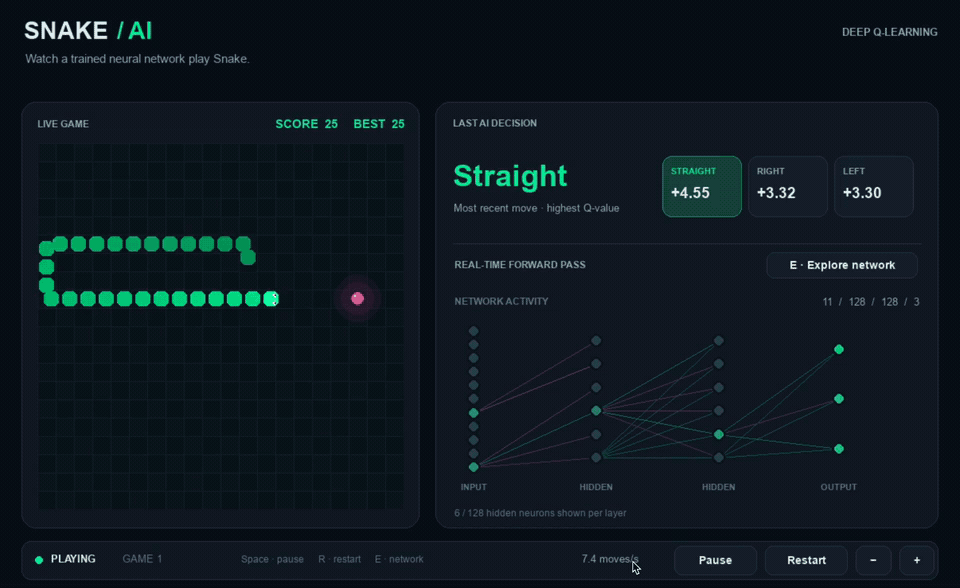
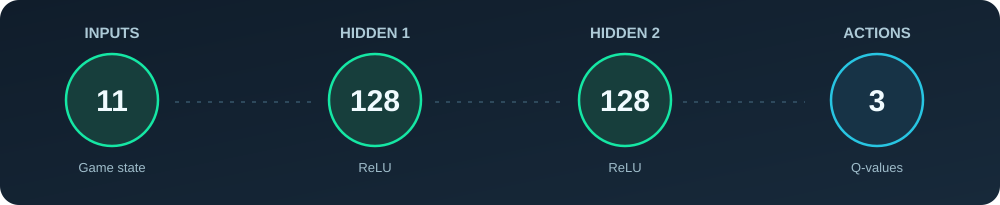
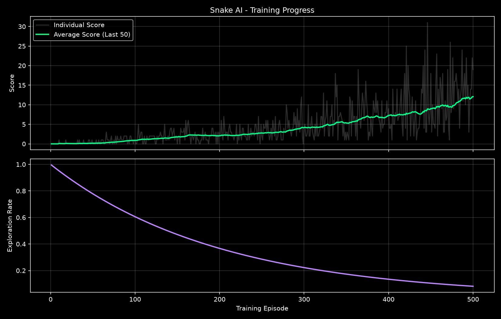

# AI Snake — Deep Q-Learning from Scratch

**A neural network learns to play Snake by trial and error.** Watch its decisions in real time, then open an interactive map of all **270 neurons** and **18,176 learned connections**.



Built in Python with **PyTorch** and **Pygame**. The AI is a custom Deep Q-Network (DQN), not a rule-based pathfinding bot. A trained checkpoint is included, so you can try the demo immediately without waiting for training.

**Evaluation highlight:** The saved DQN averaged **28.37 food per game**, compared with **0.12** for a random agent, across 100 games per policy on held-out environment seeds.

## Run the demo

Requires Python **3.12** and a desktop environment (macOS, Windows, or Linux). After cloning or downloading this repository:

```bash
python3 -m venv .venv
source .venv/bin/activate
python -m pip install -r requirements.txt
python demo.py
```

On Windows, activate with `.venv\Scripts\activate` instead.

| Key | Action |
| --- | --- |
| **Space** | Pause / resume |
| **R** | Restart the game |
| **+ / −** | Change playback speed |
| **E** | Open the full Network Explorer |
| **Esc** | Return from explorer; exit from main demo |

You can also open **E · Explore network** with the mouse. This opens the **full 270-neuron network** immediately: all 128 neurons in each hidden layer are arranged in two connected constellations. Neurons glow according to their real activations, and animated paths represent the strongest current weighted contributions. Click any neuron to highlight its incoming/outgoing connections. **Show all weights** overlays all 18,176 connections if you want to inspect the complete density.

## How the AI learns

The game exposes an **11-element state vector**: danger straight/right/left (3), the snake's current direction (4), and the food's relative position (4). The model predicts three Q-values corresponding to **straight**, **turn right**, or **turn left**.



The training loop uses:

1. **Epsilon-greedy exploration** — initially try many random actions, then increasingly choose the network's preferred move.
2. **Experience replay** — store previous transitions and learn from randomized minibatches.
3. **Target network** — periodically copy weights to stabilize Bellman targets.
4. **Huber loss + Adam** — update the policy network from temporal-difference errors.

Rewards: **+10** for food, **−10** for a collision, and **−0.01** per move. Episodes also stop after too many moves without food, avoiding endless loops.

The architecture contains **18,435 trainable parameters**, including biases. The Network Explorer reads the actual checkpoint weights and current intermediate activations; its colors and highlights are driven by the real model, not decorative animations. The main demo intentionally samples just six neurons per hidden layer to stay readable.

## Train your own agent

```bash
python train.py --episodes 500 --seed 42
```

Outputs are written to `training_output/` by default, preserving the bundled demo model:

- `training_output/models/snake_dqn.pt` — newly trained checkpoint
- `training_output/runs/training_metrics.csv` — episode-level metrics
- `training_output/runs/training_progress.png` — score and exploration plots

You can skip plotting with `--no-plot`, or choose another destination with `--output-root DIRECTORY`.

To watch the newly trained weights instead of the bundled checkpoint:

```bash
python demo.py --model training_output/models/snake_dqn.pt
```

## Evaluate rather than guess

Compare the saved greedy DQN policy to a random policy across identical environment seeds:

```bash
python evaluate.py --games 100 --seed 2026
```

The command prints each policy's mean, median, best score, and fraction of games where it ate food. It saves per-game results to `runs/evaluation.csv`. **Neither policy trains during evaluation.**

### Results from the bundled checkpoint

Each policy was evaluated on **100 games**, starting at seed `2026`. Score means the number of food items eaten before the game ends. The trained policy acts greedily (no exploration), and no learning occurs during evaluation.

| Policy | Games | Mean score | Median score | Best score | Games with food eaten |
| --- | ---: | ---: | ---: | ---: | ---: |
| Random | 100 | 0.12 | 0.00 | 2 | 10% |
| **Trained DQN** | **100** | **28.37** | **27.50** | **68** | **100%** |

The trained model scored an average of **28.25 more food items per game** than random in this evaluation. Results are specific to these 100 environment seeds; use the command above to reproduce the comparison.

## Training progress and compute

The original DQN trained for **500 episodes** on a **MacBook Pro with an Apple M3 Pro chip**, using **CPU execution with one PyTorch CPU thread** (`torch.set_num_threads(1)` in `train.py`). The original run did not record wall-clock training duration, so no runtime estimate is claimed here.



The plot shows individual game scores, a rolling average over the last 50 episodes, and the programmed exploration-rate decay. The final rolling average was **12.06 food per game**, and the best training episode scored **31**. This upward trend is evidence of improvement during training, while the separate 100-game evaluation above measures the trained greedy policy.

Training scores and independent evaluation scores measure different conditions and should not be conflated.

## Tests and development

```bash
python -m pip install -r requirements-dev.txt
python -m pytest -q
```

The test suite checks Snake mechanics, state encoding, the DQN/replay buffer, a short training run, deterministic evaluation, checkpoint loading, and the full network visualization. GitHub Actions runs the suite on each push and pull request.

### Project layout

```text
demo.py               Minimal interactive showcase
network_explorer.py   Interactive full neural-network visualization
board_renderer.py     Snake drawing (no game logic)
snake_env.py          Game rules and rewards
state_encoder.py      Eleven input features
model.py              Q-network and checkpoint loading
agent.py              Replay buffer and DQN training logic
train.py              Reproducible training CLI
evaluate.py           Paired-seed random vs. DQN evaluation
models/snake_dqn.pt   Bundled trained checkpoint
tests/                Automated regression tests
```

## Limitations

- The agent receives **11 engineered features**, not an image or the full game board.
- DQN can still fail, circle, or become trapped; improvement does not guarantee optimal play.
- The explorer shows all learned weights, but only the strongest weighted contributions are emphasized to keep a dense 18,176-edge graph readable.

This project focuses on an end-to-end reinforcement-learning system that can be trained, evaluated, inspected, and demonstrated locally.

## License

This project is licensed under the [MIT License](LICENSE).

Copyright (c) 2026 Hunter Bishop.